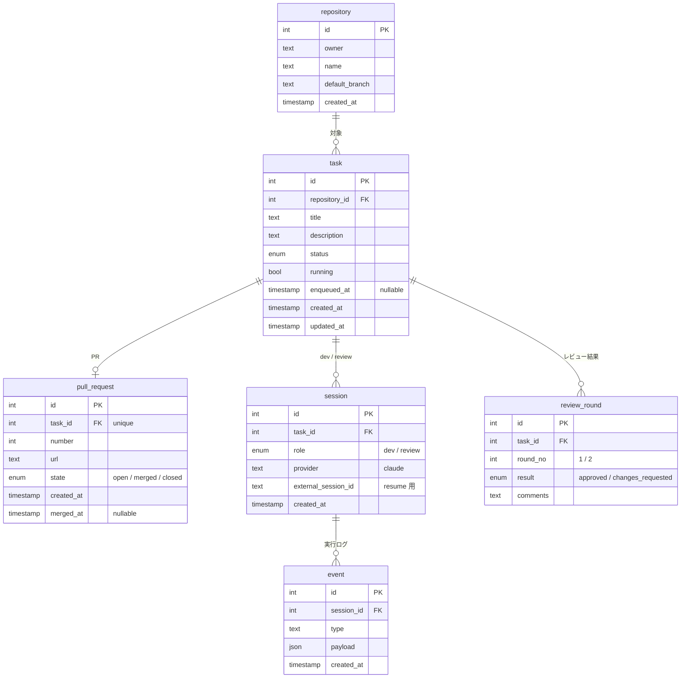

# Kobo-13900K 設計

## 概要

開発の工程をできるだけ一つにまとめるための、自分用のアプリケーション。

1. AI と話して開発タスクを発行する
2. 発行したタスクをキューに積み、AI が順に実行する
3. AI が PR を出すまでやる
4. 別のセッションの AI が PR をレビューし、元の開発 AI が対応する。これを指摘がなくなるまで繰り返す
5. 発行済み・実行中・レビュー中・完成したタスクを一覧で管理する

マージは常にユーザーが行う。

### 方針

- **直列で実行する**：トークンを使いすぎないように、タスクは並列にせずキューで1つずつ処理する
- **AI を差し替えられるようにする**：当面は開発もレビューも Claude だが、役割ごとに別の AI に替えられる作りにする
- **対象リポジトリは区別しない**：どのリポジトリも同じように扱う
- **セルフホスト**：Go で書いたサーバーを Docker で動かし、MCP サーバーとしても公開する

## MVP

### 入れるもの

- MCP からのタスク発行（Claude アプリで話して発行）
- 直列のキュー（レビュー対応を優先）
- AI によるタスク実行と PR 作成
- CI（GitHub Actions）とレビューのループ（最大2周）
- GUI での状態一覧（見るだけ）。完成タスクには PR へのリンクを付ける
- 実行フローの記録

### 後回しにするもの

- 実行中のタスクへの割り込み
- GUI からのタスク発行
- 時間帯やトークン予算を考えたスケジューリング
- モデルの選択と、Claude 以外の AI
- 通知、外部からのアクセス

## タスクの状態

```
runnable → developing → ci → reviewing → done / unresolved → finished
                              ↑      ↓
                              ci ← fix
```

| status | 意味 |
|---|---|
| `runnable` | 発行済み、実行待ち |
| `developing` | 開発中 |
| `ci` | GitHub の CI 実行中。CI が設定されていないリポジトリでは飛ばす |
| `reviewing` | レビュー中 |
| `fix` | レビューの指摘に対応中。終わったら `ci` → `reviewing` に戻る |
| `done` | 完成（レビュー通過） |
| `unresolved` | レビューを2周しても指摘が残った |
| `finished` | PR がマージまたはクローズされた。一覧には出さない |

- `done` と `unresolved` は同じ一覧に PR リンク付きで並べ、status で見分ける
- マージかクローズかの区別は `pull_request.state` で持つ
- システムエラー（API エラー、push 失敗、完了通知なしでプロセスが終わった等）は task の status にしない。event に記録し、一覧に「エラーあり」を出す

## キュー

キュー専用のテーブルは持たず、task を並べたものをキューとみなす。

- **対象**：status が `runnable` / `reviewing` / `fix` で、`running` でない task
- **順番**：`fix` を先に取り出す。それ以外は `enqueued_at` の古い順
- `enqueued_at` は、上の status になってキューに入った時刻。キューの外にいる間は空
- 割り込みはしない。実行中の task が終わってから次を取り出す

## AI との連携

- タスク1つにつき、開発セッションとレビューセッションを1つずつ持つ。2回目以降は同じセッションを resume する
- AI に渡すのは、最初のタスク本文と、`fix` のときのレビュー指摘だけ
- AI は実装して PR を作り、終わったら Kobo に完了を通知する（PR の URL と要約を添える）
- 通知を受けたら Kobo がプロセスを止めて status を進める。会話は残しておき、次に resume する

## データモデル



- `session` は `(task_id, role)` を一意にして、タスク1つにつき dev と review を1つずつに固定する。作り直しが必要になったら制約を外す
- `event` は節目だけを記録する：AI に渡したもの、AI の最終結果、セッション開始・resume、status の変化、PR・CI・レビューの結果、エラー。AI の途中の発言やコマンドは各 AI 自身の記録に任せ、event にはその記録の場所だけを残す
- タスクの実行フローは、そのタスクの dev と review の event を時系列に並べて追う

## インフラ

- サーバー：Go
- DB：PostgreSQL
- Docker で動かす。Proxmox の LXC に置く場合は nesting を有効にする
- 置き場所は未定
