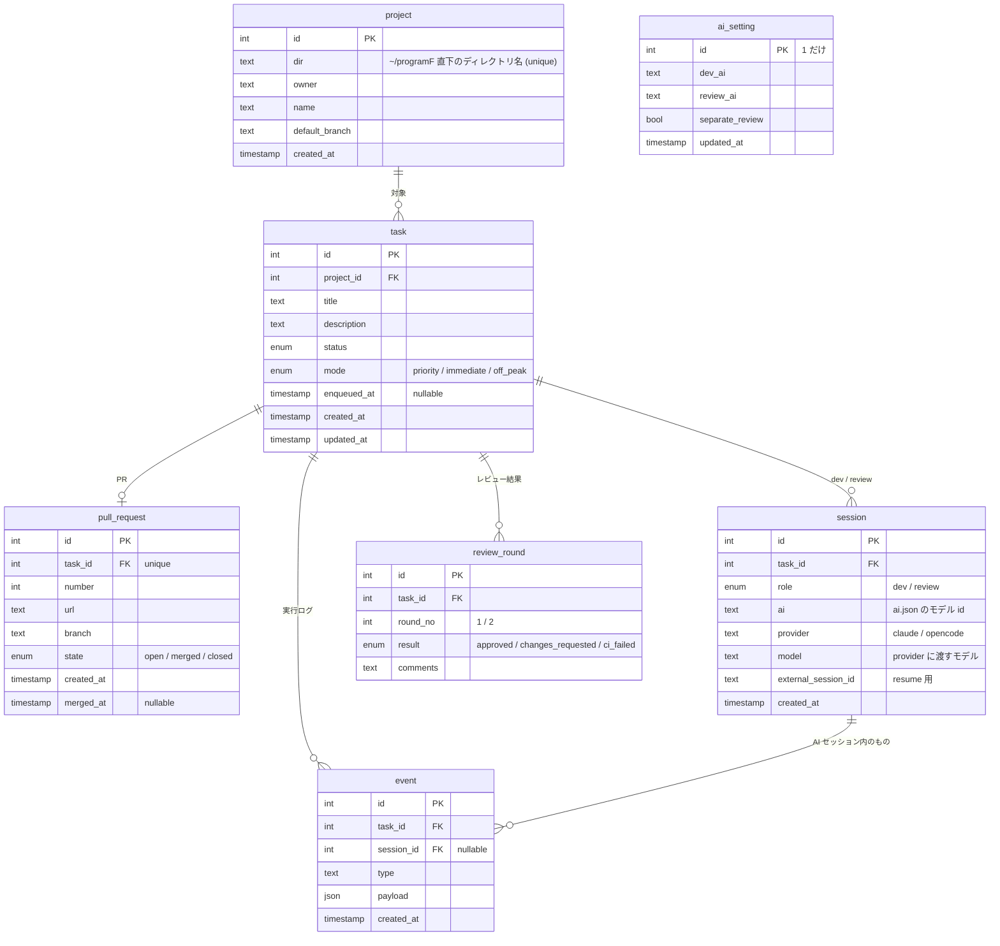

# Kobo-13900K 設計

## 概要

開発の工程をできるだけ一つにまとめるための、自分用のアプリケーション。

1. AI と話して開発タスクを発行する
2. 発行したタスクをキューに積み、AI が順に実行する
3. AI が PR を出すまでやる
4. 別のセッションの AI が PR をレビューし、元の開発 AI が対応する。これを指摘がなくなるまで繰り返す
5. 発行済み・実行中・レビュー中・完成したタスクを一覧で管理する

マージは常にユーザーが行う。

### 方針

- **直列で実行する**：トークンを使いすぎないように、タスクは並列にせずキューで1つずつ処理する
- **AI を差し替えられるようにする**：`ai.json` のカタログから開発・レビューの AI を選ぶ。モデルを増やすときは設定ファイルに1エントリ足すだけで、DB もコードも変えない
- **対象リポジトリは区別しない**：どのリポジトリも同じように扱う
- **セルフホスト**：Go で書いたサーバーを CT102 で動かし、MCP サーバーとしても公開する

## MVP

### 入れるもの

- MCP からのタスク発行（MVP では Claude Code から。操作はすべて AI 経由）
- 直列のキュー（レビュー対応を優先）
- タスクごとの実行モード：優先・通常・安い時間帯まで待つ（夜間）
- AI によるタスク実行と PR 作成
- CI（GitHub Actions）とレビューのループ（最大2周）
- GUI での状態一覧とタスク発行。PR のあるタスクには PR へのリンクと CI の状態を付ける
- 実行フローの記録

### 後回しにするもの

- 実行中のタスクへの割り込み
- トークン予算を考えたスケジューリング（安い時間帯の判定を料金体系から自動で決めることも含む）
- 通知、外部からのアクセス

## タスクの状態

```
develop → developing → ci → review → reviewing → done / unresolved → finished
                       ↑ ↘                  ↙
                       │   fix ←────────────
                       │    ↓
                       └ fixing
```

- 待ち（`develop` / `review` / `fix`）と実行中（`developing` / `reviewing` / `fixing`）は別の status にする。AI に渡すと待ちから実行中に、終わると次の待ちに移る
- `ci` から `fix` に行くのは CI が失敗したとき。`fixing` が終わると `ci`（CI がなければ `review`）に戻る
- 実行中にシステムエラーが起きたら、自動のやり直しでは同じ段階の待ちに戻る

| status | 意味 |
|---|---|
| `develop` | 発行済み、開発の順番待ち |
| `developing` | 開発中 |
| `ci` | GitHub の CI 実行中。CI が設定されていないリポジトリでは飛ばす |
| `review` | レビューの順番待ち |
| `reviewing` | レビュー中 |
| `fix` | レビューの指摘か CI の失敗への対応の順番待ち |
| `fixing` | 対応中。終わったら `ci` → `review` に戻る |
| `done` | 完成（レビュー通過） |
| `unresolved` | 2周しても指摘が残った、または CI が通らなかった |
| `finished` | PR がマージまたはクローズされた。一覧には出さない |
| `error` | システムエラー、または AI が「進められない」と報告して止まった。人が retry するまで動かない |
| `cancelled` | ユーザーが取り消した（`develop` のときだけ）。一覧には出さない |

- `done` と `unresolved` は同じ一覧に PR リンク付きで並べ、status で見分ける
- マージかクローズかの区別は `pull_request.state` で持つ

### システムエラー

API エラー、利用枠の上限、push 失敗、完了通知なしでプロセスが終わった、など。あまり起きない想定。

1. 少し間を置いて、同じ段階を自動でやり直す（2回まで）
2. それでも失敗したら status を `error` にして止める
3. 人が原因を見て retry すると、エラー前の status に戻してキューに入れる。セッションがあれば resume する

やり直した回数、エラー前の status、原因はすべて event から求める。task に列は足さない。

自動で再実行するまでの待ちは、`enqueued_at` を「次に実行してよい時刻」として少し先に設定してキューに戻すことで表す。kobo が再起動しても待ち時間は DB に残る。
`ci` の段階のエラー（GitHub の確認に失敗する等）は AI を使わないので、Kobo が自動で確認し直す。

### AI が進められないと判断したとき

AI は `report_blocked` で理由を添えて報告できる（例: 要件に大きな未定がある、仕様に無理がある、CI が落ちる原因がトークン切れなど外側にある）。
自動の再実行はせず、すぐ `error` にする。理由は event に残す。人は原因を直すか、タスクを直してから retry する。

## キュー

キュー専用のテーブルは持たず、task を並べたものをキューとみなす。

- **対象**：status が `develop` / `review` / `fix` の task
- **順番**：`fix` → `review` → 新規（`priority`）→ 新規（`immediate`）→ 新規（`off_peak`、安い時間帯の間だけ）。それぞれの中では `enqueued_at` の古い順
- mode が効くのは新規（`develop`）だけ。始まったタスクのレビューと fix は mode と時間帯に関係なく進める
- **実行モード**（`task.mode`）。GUI では 優先 / 通常 / 夜間 と表示する
  - `priority`：ほかの新規より先に実行する
  - `immediate`：順番が来しだい実行する
  - `off_peak`：開発 AI の安い時間帯になるまで待つ。時間帯は `ai.json` のモデルごとの `off_peak` に書く（例: DeepSeek のオフピーク割引の時間帯）
- `enqueued_at` は、上の status になってキューに入った時刻。キューの外にいる間は空
- 割り込みはしない。実行中の task が終わってから次を取り出す
- 取り出す条件には「`enqueued_at` が今より前」も含める

### 時間の扱い

時間管理用のテーブルは持たない。

| タイマー | 持つ場所 |
|---|---|
| off_peak の時間帯 | `ai.json`（モデルごと） |
| CI・PR のポーリング間隔 | worker の定期実行 |
| AI の実行時間の上限 | AI を起動した worker がその場で計る |
| 自動再実行までの待ち | `task.enqueued_at` |

- 時間を見て動くのは worker だけ。usecase と domain の中では待たない
- usecase は自分で時計を見ず、worker から現在時刻を引数で受け取る

## AI との連携

- **AI の選択**：`ai.json` にプロバイダー（Claude Code / opencode）とモデルのカタログを持つ。設定画面でコーディング用の AI を選び、必要なら「レビュー用AIを分ける」でレビューだけ別の AI にする。設定は DB に1行だけ持つ
- **セッションの AI は固定する**：セッションを開始したときに `ai` / `provider` / `model` を保存し、resume は設定が変わっても同じ AI・同じモデルで行う。設定変更が効くのは、まだセッションがない役割だけ
- **モデルの追加**：`ai.json` の `models` に1エントリ足す。プロバイダーの種類を増やすときだけ runner の実装が必要
- タスク1つにつき、開発セッションとレビューセッションを1つずつ持つ。2回目以降は同じセッションを resume する
- AI に渡すのは、最初のタスク本文と、`fix` のときのレビュー指摘だけ
- AI は実装して PR を作り、終わったら Kobo に完了を通知する（PR の URL と要約を添える）
- 通知を受けたら Kobo がプロセスを止めて status を進める。会話は残しておき、次に resume する
- 完了通知を出さずにプロセスが終わったら、システムエラーとして扱う
- **権限**：AI は確認なしで全部許可して動かす（Claude Code なら `--dangerously-skip-permissions`、opencode なら `--auto`）。止まらないことを優先する
- **実行時間の上限**：開発と fix は60分、レビューは30分（設定で変えられる）。超えたらプロセスを確実に止めてシステムエラーにする
- **完了通知の本人確認はしない**：直列なので、通知は常に実行中のタスクのもの。そのため時間切れのプロセスは必ず止め、遅れて届く通知が起きないようにする
- **レビュー**：レビュー AI は指摘を PR にコメントとして書き、結果を `complete_review` で Kobo に返す
- **opencode**：`opencode run --standalone --session ... --model ... --agent ... --format json --auto` で起動する。共有バックグラウンドサービスには相乗りせず、`OPENCODE_DISABLE_AUTOUPDATE=1` で自動更新も止める
- **opencode の MCP**：`mcp.servers` に `kobo-agent`（remote）と `kobo-playwright`（local）を書いた設定を、環境変数 `OPENCODE_CONFIG_CONTENT` で渡す。opencode はリポジトリの `opencode.json` とこれをマージする。worktree にはファイルを置かないので、AI が誤って commit することがない。`OPENCODE_CONFIG_CONTENT` を読むのは `--standalone` の専用サーバーだけ
- **ブラウザ**：AI を起動するとき、Kobo の MCP と並べて Playwright の MCP サーバーを渡す。画面の動作確認はこれで行う
  - ヘッドレスの chromium で動かす。プロファイルはメモリ上に置き、タスクの間で共有しない
  - スナップショットなどの出力先は `{log_dir}/playwright/{ログ名}`。worktree に出すと AI が誤って commit しかねないため
  - Playwright MCP は常駐させない。AI の子プロセスとして毎回起動し、AI と一緒に終わる
  - Kobo はインストールしない。`KOBO_PLAYWRIGHT_MCP_BIN` で指定された実行ファイルを使う。chromium の導入は明示的なセットアップ手順で行う
  - `KOBO_BROWSER=off` を明示したときだけブラウザなしで動く。デフォルトは `on` で、見つからなければ起動しない
  - `npx` や対話シェルの PATH 読み込みは使わない。起動時に解決した実行ファイルだけを使う

### AI モデルの設定

`ai.json` にプロバイダーとモデルを書く。`KOBO_AI_CONFIG` でパスを指定する。

```json
{
  "providers": {
    "claude": { "runner": "claude", "bin": "claude" },
    "opencode": { "runner": "opencode", "bin": "opencode", "agent": "build" }
  },
  "models": [
    { "id": "claude", "label": "Claude", "provider": "claude",
      "off_peak": {
        "mon": ["19:00-10:00"], "tue": ["19:00-10:00"], "wed": ["19:00-10:00"],
        "thu": ["19:00-10:00"], "fri": ["19:00-10:00"], "sat": ["19:00-10:00"],
        "sun": ["19:00-10:00"] } },
    { "id": "deepseek-v4.1-flash", "label": "DeepSeek V4.1 Flash",
      "provider": "opencode", "model": "opencode-go/deepseek-v4.1-flash",
      "off_peak": {
        "mon": ["13:00-15:00", "19:00-10:00"],
        "tue": ["13:00-15:00", "19:00-10:00"],
        "wed": ["13:00-15:00", "19:00-10:00"],
        "thu": ["13:00-15:00", "19:00-10:00"],
        "fri": ["13:00-15:00", "19:00-10:00"],
        "sat": ["00:00-24:00"],
        "sun": ["00:00-24:00", "19:00-10:00"] } }
  ]
}
```

- `id` は DB に保存するので変えない。表示名は `label`、opencode に渡すモデルは `model`。
- `off_peak` は全モデルで必須。曜日 `mon`〜`sun` ごとに時間帯を並べる。1日に複数書ける。
  - 時間帯は `"HH:MM-HH:MM"` で、kobo のローカル時刻。終了が開始より早いもの（例: `"19:00-10:00"`）は、開始した曜日に属し、翌日の終了時刻まで続く。
  - `"00:00-24:00"` は終日。重なった時間帯は和集合として扱う。
  - 7曜日すべて必要。時間帯がない日は `[]`。祝日は判定せず平日として扱う。
  - off_peak タスクを始めてよいかの判定には、設定の開発 AI の時間帯を使う。レビューと fix は時間帯に関係なく始める。
- カタログは起動時に読む。`ai.json` を変えたら kobo を再起動する。
- `model` が空ならその CLI のデフォルト（Claude はこれ）。
- 設定画面では「コーディング用AI」を選び、「レビュー用AIを分ける」をオンにしたときだけ「レビュー用AI」を選ぶ。オフのときはレビューもコーディングと同じ AI を使う。
- DB の `ai_setting` は1行だけ。`dev_ai` / `review_ai` / `separate_review` を持つ。
- セッション開始時に選んだ `ai` / `provider` / `model` を `session` に保存し、resume はそれを正とする。

### 作業ディレクトリ

- リポジトリは `~/programF` の下にあるものを使う
- ユーザーの作業ディレクトリには触れない。`git fetch` してから `origin/<default_branch>` を元に git worktree を作り、そこで作業する
- worktree は作業が終わったら必ず消す。fix のときは PR のブランチから worktree を作り直す
- セッションは worktree の中で立てる。resume はセッション ID を指定すれば別のディレクトリからでもできる（Claude Code 2.1.317 で確認）。AI が迷わないよう、作り直す worktree は前回と同じパスにする

## 機能とエンドポイント

### ユーザー向け

GUI からは REST、AI（Claude Code / opencode）からは同じ機能を MCP ツールとして呼ぶ。

| メソッド | パス | MCP ツール | 内容 |
|---|---|---|---|
| GET | `/projects` | `list_projects` | 登録済みプロジェクト（リポジトリ）一覧 |
| GET | `/projects/candidates` | - | `~/programF` 直下のディレクトリ一覧。登録済みか、登録できない理由（git ではない / origin が GitHub ではない）を付ける |
| POST | `/projects` | - | ディレクトリ名を指定してプロジェクトを登録する |
| POST | `/tasks` | `create_task` | タスク発行。ディレクトリ名・タイトル・本文・mode を指定。未登録のリポジトリならここで登録し、owner / name / default_branch は git remote から埋める |
| GET | `/tasks` | `list_tasks` | タスク一覧。status で絞り込み、`finished` は既定で除く。各タスクにプロジェクトのディレクトリ名、PR の URL と番号、最新の CI の状態（pending / success / failure）を付ける |
| GET | `/tasks/{id}` | `get_task` | 詳細。PR リンク、レビュー結果、開発・レビューのセッションで使った AI |
| GET | `/tasks/{id}/events` | `get_task_events` | 実行フロー（dev と review の event を時系列で） |
| PATCH | `/tasks/{id}` | `update_task` | タイトル・本文・mode の変更。`develop` と `error` の間だけ |
| POST | `/tasks/{id}/cancel` | `cancel_task` | 取り消し。`develop` の間だけ。`cancelled` にする |
| POST | `/tasks/{id}/retry` | `retry_task` | `error` のタスクを、エラー前の status に戻してキューに入れる |
| GET | `/queue` | `get_queue` | 次に実行される順のタスク一覧 |
| GET | `/ai` | - | AI モデルのカタログ（各モデルの `off_peak` を含む）と、いまの開発・レビューの選択 |
| PUT | `/ai/setting` | - | 開発・レビューの AI を変更する。`separate_review` で分離する |

### AI 向け

実行中の AI だけが呼ぶ MCP ツール。ユーザー向けとは別のエンドポイント `/mcp/agent` で受ける。

| MCP ツール | 内容 |
|---|---|
| `complete_development` | 開発・fix の完了通知。PR の URL と要約 |
| `complete_review` | レビューの完了通知。approved / changes_requested と指摘 |
| `report_blocked` | これ以上進められないことの報告。理由を添える。task は `error` になる |

### その他

| メソッド | パス | 内容 |
|---|---|---|
| GET | `/` | GUI（状態一覧の画面） |
| GET | `/events` | 変更通知（SSE）。GUI が開いている間つなぎっぱなしにする |
| GET | `/health` | 生存確認 |

### 変更通知（SSE）

バックエンドでの変更を、GUI にすぐ反映する。

- `GET /events` は `text/event-stream` で、task が変わるたびに `{"task_id": 15}` を流す。中身は ID だけで、GUI は一覧を `GET /tasks` で取り直し、その task の詳細を開いていれば詳細も取り直す（データの形は REST のものだけにする）
- 配るのは usecase の notifier。task を変える usecase（task / queue / completion / ci / pr）が、トランザクションのコミット後に呼ぶ。kobo は1プロセスなので、プロセス内で購読者ごとのチャネルに配るだけでよい
- GUI は `EventSource` でつなぐ。切れたら自動でつなぎ直し、つなぎ直したときは一覧を丸ごと取り直す（切れている間の通知は追わない）
- 経過時間などの時間で変わる表示は、サーバーから流さず GUI が数える

### システム内部

- キューから次の task を取り出し、AI を起動または resume する
- `ci` の task の CI 結果を GitHub にポーリングで確認する
  - 判定：PR の最新コミットの check がすべて終わったら完了
  - 成功なら `review`、失敗なら `fix`（直すのは開発 AI）
  - CI の有無はリポジトリに `.github/workflows` があるかで判定する。ない場合は `ci` を飛ばす
- PR のマージ・クローズを検知して `finished` にする
- 各段階で event を記録する

## AI への指示文

Kobo が AI を起動・resume するときに渡す文章。`{...}` は Kobo が埋める。どの AI でも使えるよう、特定の AI に依存した書き方はしない。

### 開発（developing）

```
あなたは Kobo から開発タスクを受け取った開発担当です。
作業ディレクトリ {worktree} は {owner}/{name} の {default_branch} から作った git worktree です。

# タスク
{title}

{description}

# 進め方
- このディレクトリの中だけで作業する。リポジトリの AGENTS.md / CLAUDE.md があれば従う
- ブランチ名は kobo/task-{task_id}
- 質問はできない。細かい未定は妥当な方を選んで進め、選んだ内容を PR に書く
- ただし、どちらを選ぶかで作るものが大きく変わる未定（画面の構成、データの持ち方、外から見える振る舞いなど）が要件にあれば、作業を始めずに report_blocked を呼び、何が決まっていないかと、考えられる選択肢を書く
- テストやビルドの方法があれば、PR を出す前に通す
- 画面の動作確認は Playwright のブラウザで行う
- 終わったら push し、{default_branch} 向けの PR を gh で作る

# スクリーンショット
- 画面の見た目や操作が変わる変更をしたら、変更後の画面をブラウザで開いてスクリーンショットを撮る。どの画面をどの画面サイズで撮るかは自分で決める
- 撮った画像を {shots_repo} の main ブランチの {name}/task-{task_id}-<連番>.png に置いて push する。連番は 1 から始め、すでにある番号は上書きせず続きの番号を使う
- {shots_repo} は作業ディレクトリの外の一時ディレクトリに clone してよい（ここだけは作業ディレクトリの外に出てよい）
- PR の本文に、 の形で画像を貼る
- 画面に関わらない変更なら撮らない

# PR の本文
- 何をしたか
- 自分で判断して決めたこと（仕様が書かれていなかった所、複数の選択肢から選んだ所）と、その理由。なければ「なし」
- 確認したこと（実行したテストなど）

# 終わり方
- PR を作ったら complete_development を呼ぶ（PR の URL と要約）
- 進められない場合（要件に大きな未定がある、仕様に無理がある、外部の問題でテストや CI が通らない等）は、PR を作らずに report_blocked を呼び、理由を書く
- どちらかを呼んだら、それ以上は何もしない
```

### 対応（fixing）

```
PR {pr_url} に次の指摘がありました。対応してください。
作業ディレクトリ {worktree} は PR のブランチから作り直した worktree です。

# 指摘
{comments}            ← レビューの指摘、または CI の失敗内容

# 進め方
- 指摘ごとに直す。直さないと判断したものは理由を書く
- 同じブランチに push する（新しい PR は作らない）
- PR に、何をどう直したか、自分で判断して決めたことをコメントで書く
- 画面の動作確認は Playwright のブラウザで行う

# スクリーンショット
- 画面の見た目や操作が変わる変更をしたら、変更後の画面をブラウザで開いてスクリーンショットを撮る。どの画面をどの画面サイズで撮るかは自分で決める
- 撮った画像を {shots_repo} の main ブランチの {name}/task-{task_id}-<連番>.png に置いて push する。連番は 1 から始め、すでにある番号は上書きせず続きの番号を使う
- {shots_repo} は作業ディレクトリの外の一時ディレクトリに clone してよい（ここだけは作業ディレクトリの外に出てよい）
- PR のコメントに、 の形で画像を貼る
- 画面に関わらない変更なら撮らない

# 終わり方
- push したら complete_development を呼ぶ
- 進められない場合は report_blocked を呼ぶ
```

### レビュー（reviewing）

```
あなたは Kobo から PR のレビューを頼まれたレビュー担当です。
PR: {pr_url}（{round_no} 周目 / 最大 {max_rounds} 周）
元のタスク:
{title}

{description}

# 見ること
- タスクの内容を満たしているか
- バグ、壊れるケース、セキュリティの問題
- PR に書かれた「自分で判断して決めたこと」が妥当か
- 好みの問題や細かい書き方は指摘しない。直さないとマージできないものだけを指摘する
- 画面の動作確認は Playwright のブラウザで行う
- 画面を変える PR で、スクリーンショットがないために動作確認の手間が大きくなる場合は、スクリーンショットを求める指摘をする

# 書き方
- 指摘は gh で PR のレビューコメントとして書く（該当する行に付けられるものは行に付ける）
- コードは変更しない

# 終わり方
- 指摘がなければ complete_review を approved で呼ぶ
- 指摘があれば complete_review を changes_requested で呼び、指摘の一覧を渡す
- 2周目以降は、前回の指摘が直ったかも確認する
```

## データモデル



- `review_round` は CI の失敗も1周として記録する（`result` = `ci_failed`）。レビューと CI の失敗を合わせて最大2周
- `session` は `(task_id, role)` を一意にして、タスク1つにつき dev と review を1つずつに固定する。作り直しが必要になったら制約を外す
- `session` の `ai` / `provider` / `model` は開始時に固定する。設定や `ai.json` が変わっても resume は同じ組み合わせを使う
- `ai_setting` は1行だけ。`dev_ai` / `review_ai` / `separate_review` を持ち、カタログのモデル id を保存する。カタログは `ai.json` が正で、DB にモデル定義は持たない
- `event` は task に紐づく。AI のセッション内で起きたものは `session_id` も持つ（CI の結果などセッション外の event もあるため）
- `event` は節目だけを記録する：AI に渡したもの、AI の最終結果、セッション開始・resume、status の変化、PR・CI・レビューの結果、エラー。AI の途中の発言やコマンドは各 AI 自身の記録に任せ、event にはその記録の場所だけを残す
- タスクの実行フローは、そのタスクの dev と review の event を時系列に並べて追う
- 作業対象のリポジトリは `project` と呼ぶ。repository 層と名前がぶつからないようにするため

## インフラ

```
 Claude Code ──MCP──┐
 ブラウザ (GUI) ─HTTP┤
                    ▼
 ┌──────────────── CT102 ────────────────────────┐
 │ kobo (Go, systemd で常駐)                      │
 │  ├ rest / mcp  REST と MCP の受け口            │
 │  ├ scheduler   キューから次の task を取り出す  │
 │  ├ runner      AI を起動・resume する          │──▶ claude CLI / opencode（satoru314 として実行）──▶ Playwright MCP（headless chromium）
 │  ├ watcher     CI と PR の状態をポーリング     │──▶ GitHub
 │  └ worktree    worktree の作成・削除           │──▶ ~/programF 配下
 │ postgres (Docker)                              │
 └────────────────────────────────────────────────┘
```

- **kobo**：CT102 の上で直接動かす。本番は systemd のサービス、開発中は `go run`
- **AI**：CT102 の上で satoru314 として動かす。普段の開発環境のツールがそのまま使える。完了通知は localhost の MCP で kobo に返す
- **DB**：PostgreSQL を Docker で動かす。`compose.yaml` は Postgres 用だけ
- **runner** は AI ごとに差し替える部品。「タスクを渡して起動」「resume」「完了通知を待つ」だけを決め、Claude 用と opencode 用がその実装
- **ネットワーク**：LAN 内だけ。claude.ai のカスタムコネクタは Anthropic のサーバーから接続するため LAN 内の MCP には届かない。Claude アプリから使うには外への公開と認証が必要（後回し）

### 準備が要ること

- CT102 の satoru314 を docker グループに入れる（root が必要）
- CT102 で Docker を動かすため、CT の nesting が有効か確認する
- `claude` / `opencode` / `gh` / `git` / `playwright-mcp` を入れる。chromium も Playwright のセットアップ手順で入れる
- Kobo はこれらをインストールしない。`make check` で存在と最低バージョンを確認し、足りなければ起動しない
- `KOBO_AI_CONFIG` に `ai.json` のパスを指定する。`KOBO_BROWSER=off` のときだけブラウザなしで動く

### 設定

環境変数で渡す。既定値のないものが未設定なら kobo は起動しない。

| 環境変数 | 既定値 | 内容 |
|---|---|---|
| `KOBO_DATABASE_URL` | なし（必須） | Postgres の接続先 |
| `KOBO_SHOTS_REPO` | なし（必須） | スクリーンショットを置く非公開リポジトリ。`owner/name` の形（例: `Satoru314/kobo-shots`） |
| `KOBO_LISTEN` | `127.0.0.1:8787` | HTTP の待ち受け |
| `KOBO_CLAUDE_BIN` | `claude` | claude CLI のパス |
| `KOBO_LOG_DIR` | `~/.kobo/logs` | ログの置き場所 |
| `KOBO_PROJECTS_DIR` | `~/programF` | 対象リポジトリを置くディレクトリ |
| `KOBO_WORKTREES_DIR` | `~/.kobo/worktrees` | worktree を作るディレクトリ |
| `KOBO_MAX_REVIEW_ROUNDS` | `2` | レビューの上限回数 |
| `KOBO_DEV_TIMEOUT` | `60m` | 開発と fix の実行時間の上限 |
| `KOBO_REVIEW_TIMEOUT` | `30m` | レビューの実行時間の上限 |
| `KOBO_MAX_AUTO_RETRIES` | `2` | システムエラーで自動再実行する回数 |
| `KOBO_RETRY_DELAY` | `1m` | 自動再実行までの待ち |

### スクリーンショットの置き場所

- 画面を変えた PR のスクリーンショットは、`KOBO_SHOTS_REPO` のリポジトリの main ブランチに置く
- 置く場所は `<対象リポジトリ名>/task-<番号>-<連番>.png`（例: `Kobo-13900K/task-2-1.png`）
- PR には `https://github.com/<KOBO_SHOTS_REPO>/blob/main/<パス>?raw=true` で貼る
- 撮る・置く・貼るのは AI の仕事で、kobo は指示文でリポジトリ名を伝えるだけ

## ファイル配置

テストファイル（`_test.go`）は各ファイルの隣に置く。

```
Kobo-13900K/
├── Makefile                       make migrate（マイグレーション）、make check（起動前の確認）
├── ai.json                        AI プロバイダーとモデルのカタログ
├── api/
│   ├── migrations/                SQL のマイグレーション（テーブル定義の正）。make migrate で適用する
│   └── src/
│       ├── cmd/
│       │   ├── kobo/              main.go 組み立てと起動・停止、config.go 設定の読み込み、preflight.go 起動前の確認
│       │   └── migrate/           make migrate の中身
│       │
│       ├── domain/                テーブルごとの型、列の値の定数とその Valid()、ErrNotFound。規則は置かない
│       │
│       ├── usecase/               kobo がやること全部。Usecase 1つで、ファイルは主題ごと
│       │   ├── usecase.go         Usecase、Settings、エラー
│       │   ├── ports.go           usecase が使う外側のインターフェース（DB、RepoHost、AI、Notifier）
│       │   ├── dto.go             domain の型にない形の入出力（TaskSummary、TaskDetail など）
│       │   ├── rules.go           共通の規則（ステータスの遷移、開始・待ちへの戻し、編集の可否、次のステータス、夜間の時間帯）
│       │   ├── record.go          event の記録、ステータスの移動、レビューの周回の記録
│       │   ├── task.go            発行・一覧・詳細・実行フロー・編集・取り消し・再実行
│       │   ├── project.go         一覧・候補・登録
│       │   ├── queue.go           キューの順番・一時停止・再開・RunNext（取り出し→実行→後始末）・起動時の回収
│       │   ├── report.go          AI の報告（完了・レビュー結果・進められない）
│       │   ├── watch.go           CI と PR の確認
│       │   ├── activerun.go       実行中の AI を止めるためのスイッチ
│       │   ├── history.go         event から求めるもの（直前のステータス、連続失敗数など）
│       │   ├── ai.go              AI の設定・カタログ・セッション開始時のモデル解決
│       │   └── prompt.go          AI への指示文
│       │
│       ├── repository/            外の世界とのやりとり
│       │   ├── model/             GORM で読み書きする行の型（Model）
│       │   ├── db*.go             DB（Postgres、GORM）。次に実行するタスクの並び順は db_task.go の SQL
│       │   ├── migrate.go         マイグレーションの適用と未適用の確認
│       │   ├── repohost.go        RepoHost（git と gh）
│       │   ├── aiconfig.go        ai.json の読み込みと検証（usecase.Catalog）
│       │   ├── mcp.go             MCP サーバーの共通形と Claude / opencode への変換
│       │   ├── runner_claude.go   AI（Claude Code）
│       │   ├── runner_opencode.go AI（opencode）
│       │   ├── playwright.go      AI に渡すブラウザ（Playwright MCP）
│       │   └── command.go         外部コマンドの実行
│       │
│       ├── notify/                変更の通知（GUI の /events へ）と、キューの worker を起こす合図
│       │
│       └── controller/
│           ├── schema/            REST と MCP が送受信する形（Schema）と、usecase の結果からの詰め替え
│           ├── rest/              Echo のルートとハンドラ
│           ├── mcp/               MCP サーバー（ユーザー用 /mcp、AI 用 /mcp/agent）
│           ├── worker/            キューの worker と、CI・PR のポーリング
│           └── web/               埋め込んだ GUI を / で配信（dist/ は app/ のビルド結果）
│
├── app/                           フロント（Vite + React + TypeScript）
├── docs/design.md
├── compose.yaml                   Postgres
└── .env.example```

### 層のルール

- 依存の向きは controller → usecase → domain、repository → usecase（usecase の定めるインターフェースを実装する）、どこからも domain
- **domain** はテーブルと同じ形の型と、列の値の定数、その `Valid()` だけ。規則は usecase に置く
- **usecase** は1つの `Usecase`。使う外側（DB、RepoHost、AI、Notifier）は `ports.go` のインターフェースで受ける。入出力は domain の型をそのまま使い、domain にない形のときだけ DTO（`dto.go`）を作る。DTO は domain にだけ依存する
- **repository** の DB は GORM で、行の型（Model、`repository/model`）と domain を詰め替える。`AutoMigrate` は使わず、テーブル定義はマイグレーションの SQL を正とする
- **controller** は usecase の結果を Schema（`controller/schema`）に詰め替えて返す。使う usecase のメソッドは、controller ごとに自分の側でインターフェースとして定義する
- 型の名前: フロントに送る型は Schema、usecase の入出力は DTO、repository の行は Model
- DI のフレームワークは使わない。`cmd/kobo` で手で組み立てる
- 起動時にマイグレーションを適用しない。未適用のものがあれば起動しない（`make migrate` で適用する）
- 起動時に外部コマンドとディレクトリを確認する。コマンドがないとき、`--version` の出力から版を読めないとき、版が kobo の使う機能の最低バージョンより古いときは起動しない。機能を試して判定せず、最低バージョンとの比較で判定する。最低バージョンは `preflight.go` の表で1か所に管理し、実行ファイルの名前ではなく役割（gh、git、claude、opencode、playwright-mcp）で引く。`make check` でも同じ確認ができる
- 実行時にパッケージやブラウザをインストールしない。`npx` や対話シェルの PATH 読み込みも使わない

### worker

時間やきっかけで kobo が自分で動かす入口。何をいつ呼ぶかだけを決め、処理は usecase、GitHub とのやりとりは repository が行う。

| worker | 内容 |
|---|---|
| キューの取り出し | 実行中の task がなければ次を取り出して AI に渡す。タスクの発行や AI の完了通知を合図にすぐ動き、定期的な確認は `off_peak` の時間帯に入ったことに気づくための保険 |
| CI の確認 | `ci` の task の CI 結果をポーリングする |
| PR の確認 | 完成した PR のマージ・クローズをポーリングして `finished` にする |

最終的には、CI と PR の確認も GitHub の webhook を受けるイベント駆動に置き換えたい。

Go のバージョンは `go.mod` の `go` / `toolchain` で固定する。
