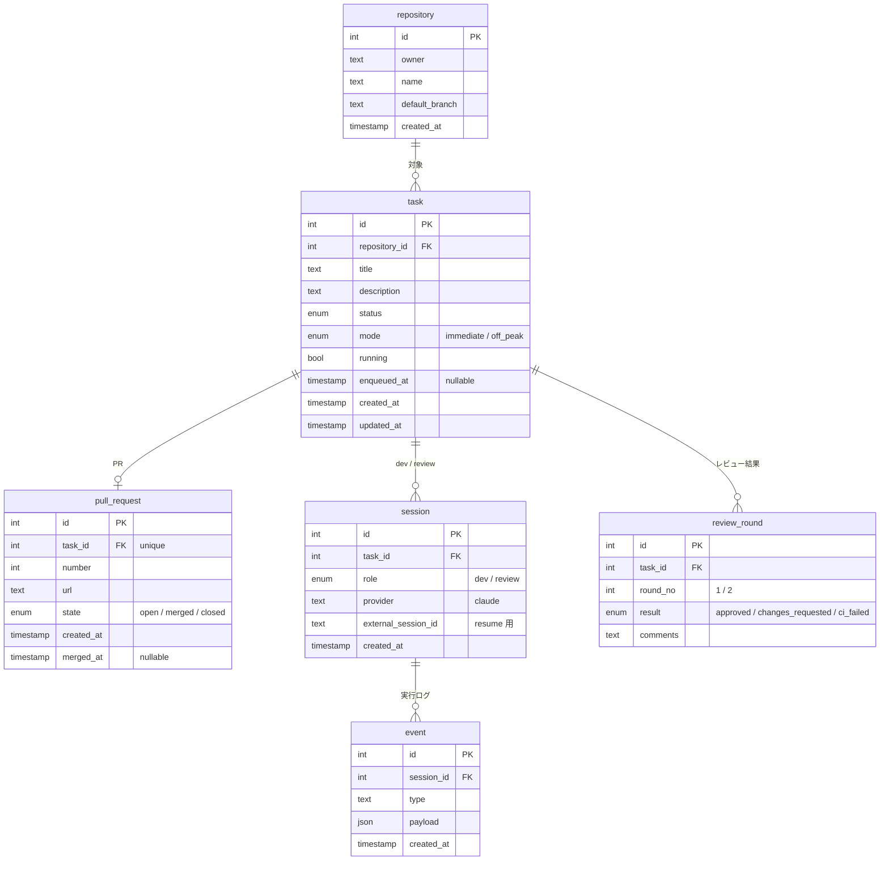

# Kobo-13900K 設計

## 概要

開発の工程をできるだけ一つにまとめるための、自分用のアプリケーション。

1. AI と話して開発タスクを発行する
2. 発行したタスクをキューに積み、AI が順に実行する
3. AI が PR を出すまでやる
4. 別のセッションの AI が PR をレビューし、元の開発 AI が対応する。これを指摘がなくなるまで繰り返す
5. 発行済み・実行中・レビュー中・完成したタスクを一覧で管理する

マージは常にユーザーが行う。

### 方針

- **直列で実行する**：トークンを使いすぎないように、タスクは並列にせずキューで1つずつ処理する
- **AI を差し替えられるようにする**：当面は開発もレビューも Claude だが、役割ごとに別の AI に替えられる作りにする
- **対象リポジトリは区別しない**：どのリポジトリも同じように扱う
- **セルフホスト**：Go で書いたサーバーを CT102 で動かし、MCP サーバーとしても公開する

## MVP

### 入れるもの

- MCP からのタスク発行（MVP では Claude Code から。操作はすべて AI 経由）
- 直列のキュー（レビュー対応を優先）
- タスクごとの実行モード：すぐ実行するか、安い時間帯まで待つか
- AI によるタスク実行と PR 作成
- CI（GitHub Actions）とレビューのループ（最大2周）
- GUI での状態一覧（見るだけ）。完成タスクには PR へのリンクを付ける
- 実行フローの記録

### 後回しにするもの

- 実行中のタスクへの割り込み
- GUI からのタスク発行
- トークン予算を考えたスケジューリング（安い時間帯の判定を料金体系から自動で決めることも含む）
- モデルの選択と、Claude 以外の AI
- 通知、外部からのアクセス

## タスクの状態

```
runnable → developing → ci → reviewing → done / unresolved → finished
                              ↑      ↓
                              ci ← fix
```

| status | 意味 |
|---|---|
| `runnable` | 発行済み、実行待ち |
| `developing` | 開発中 |
| `ci` | GitHub の CI 実行中。CI が設定されていないリポジトリでは飛ばす |
| `reviewing` | レビュー中 |
| `fix` | レビューの指摘に対応中。終わったら `ci` → `reviewing` に戻る |
| `done` | 完成（レビュー通過） |
| `unresolved` | 2周しても指摘が残った、または CI が通らなかった |
| `finished` | PR がマージまたはクローズされた。一覧には出さない |
| `error` | システムエラー、または AI が「進められない」と報告して止まった。人が retry するまで動かない |

- `done` と `unresolved` は同じ一覧に PR リンク付きで並べ、status で見分ける
- マージかクローズかの区別は `pull_request.state` で持つ

### システムエラー

API エラー、利用枠の上限、push 失敗、完了通知なしでプロセスが終わった、など。あまり起きない想定。

1. 少し間を置いて、同じ段階を自動でやり直す（2回まで）
2. それでも失敗したら status を `error` にして止める
3. 人が原因を見て retry すると、エラー前の status に戻してキューに入れる。セッションがあれば resume する

やり直した回数、エラー前の status、原因はすべて event から求める。task に列は足さない。
`ci` の段階のエラー（GitHub の確認に失敗する等）は AI を使わないので、Kobo が自動で確認し直す。

### AI が進められないと判断したとき

AI は `report_blocked` で理由を添えて報告できる（例: 仕様に無理がある、CI が落ちる原因がトークン切れなど外側にある）。
自動の再実行はせず、すぐ `error` にする。理由は event に残す。人は原因を直すか、タスクを直してから retry する。

## キュー

キュー専用のテーブルは持たず、task を並べたものをキューとみなす。

- **対象**：status が `runnable` / `reviewing` / `fix` で、`running` でない task
- **順番**：`fix` → `immediate` → `off_peak`（安い時間帯の間だけ）。それぞれの中では `enqueued_at` の古い順
- **実行モード**（`task.mode`）
  - `immediate`：順番が来しだい実行する
  - `off_peak`：安い時間帯になるまで待つ。安い時間帯は設定で時刻の範囲として決める（例: DeepSeek のオフピーク割引の時間帯）
- `enqueued_at` は、上の status になってキューに入った時刻。キューの外にいる間は空
- 割り込みはしない。実行中の task が終わってから次を取り出す

## AI との連携

- タスク1つにつき、開発セッションとレビューセッションを1つずつ持つ。2回目以降は同じセッションを resume する
- AI に渡すのは、最初のタスク本文と、`fix` のときのレビュー指摘だけ
- AI は実装して PR を作り、終わったら Kobo に完了を通知する（PR の URL と要約を添える）
- 通知を受けたら Kobo がプロセスを止めて status を進める。会話は残しておき、次に resume する
- 完了通知を出さずにプロセスが終わったら、システムエラーとして扱う

### 作業ディレクトリ

- リポジトリは `~/programF` の下にあるものを使う
- ユーザーの作業ディレクトリには触れない。`git fetch` してから `origin/<default_branch>` を元に git worktree を作り、そこで作業する
- worktree は作業が終わったら必ず消す。fix のときは PR のブランチから worktree を作り直す
- セッションは worktree の中で立てる。resume はセッション ID を指定すれば別のディレクトリからでもできる（Claude Code 2.1.317 で確認）。AI が迷わないよう、作り直す worktree は前回と同じパスにする

## 機能とエンドポイント

### ユーザー向け

GUI からは REST、AI（Claude Code）からは同じ機能を MCP ツールとして呼ぶ。

| メソッド | パス | MCP ツール | 内容 |
|---|---|---|---|
| GET | `/repositories` | `list_repositories` | 登録済みリポジトリ一覧 |
| POST | `/tasks` | `create_task` | タスク発行。ディレクトリ名・タイトル・本文・mode を指定。未登録のリポジトリならここで登録し、owner / name / default_branch は git remote から埋める |
| GET | `/tasks` | `list_tasks` | タスク一覧。status で絞り込み、`finished` は既定で除く |
| GET | `/tasks/{id}` | `get_task` | 詳細。PR リンク、レビュー結果 |
| GET | `/tasks/{id}/events` | `get_task_events` | 実行フロー（dev と review の event を時系列で） |
| PATCH | `/tasks/{id}` | `update_task` | タイトル・本文・mode の変更。`runnable` と `error` の間だけ |
| POST | `/tasks/{id}/cancel` | `cancel_task` | 取り消し。`runnable` の間だけ（取り消し後の status は未決） |
| POST | `/tasks/{id}/retry` | `retry_task` | `error` のタスクを、エラー前の status に戻してキューに入れる |
| GET | `/queue` | `get_queue` | 次に実行される順のタスク一覧 |

### AI 向け

実行中の AI だけが呼ぶ MCP ツール。

| MCP ツール | 内容 |
|---|---|
| `complete_development` | 開発・fix の完了通知。PR の URL と要約 |
| `complete_review` | レビューの完了通知。approved / changes_requested と指摘 |
| `report_blocked` | これ以上進められないことの報告。理由を添える。task は `error` になる |

### その他

| メソッド | パス | 内容 |
|---|---|---|
| GET | `/` | GUI（状態一覧の画面） |
| GET | `/health` | 生存確認 |

### システム内部

- キューから次の task を取り出し、AI を起動または resume する
- `ci` の task の CI 結果を GitHub にポーリングで確認する
  - 判定：PR の最新コミットの check がすべて終わったら完了
  - 成功なら `reviewing`、失敗なら `fix`（直すのは開発 AI）
  - CI の有無はリポジトリに `.github/workflows` があるかで判定する。ない場合は `ci` を飛ばす
  - CI の状態を GUI に出すのは後回し
- PR のマージ・クローズを検知して `finished` にする
- 各段階で event を記録する

## データモデル



- `review_round` は CI の失敗も1周として記録する（`result` = `ci_failed`）。レビューと CI の失敗を合わせて最大2周
- `session` は `(task_id, role)` を一意にして、タスク1つにつき dev と review を1つずつに固定する。作り直しが必要になったら制約を外す
- `event` は節目だけを記録する：AI に渡したもの、AI の最終結果、セッション開始・resume、status の変化、PR・CI・レビューの結果、エラー。AI の途中の発言やコマンドは各 AI 自身の記録に任せ、event にはその記録の場所だけを残す
- タスクの実行フローは、そのタスクの dev と review の event を時系列に並べて追う

## インフラ

```
 Claude Code ──MCP──┐
 ブラウザ (GUI) ─HTTP┤
                    ▼
 ┌──────────────── CT102 ────────────────────────┐
 │ kobo (Go, systemd で常駐)                      │
 │  ├ rest / mcp  REST と MCP の受け口            │
 │  ├ scheduler   キューから次の task を取り出す  │
 │  ├ runner      AI を起動・resume する          │──▶ claude CLI（satoru314 として実行）
 │  ├ watcher     CI と PR の状態をポーリング     │──▶ GitHub
 │  └ worktree    worktree の作成・削除           │──▶ ~/programF 配下
 │ postgres (Docker)                              │
 └────────────────────────────────────────────────┘
```

- **kobo**：CT102 の上で直接動かす。本番は systemd のサービス、開発中は `go run`
- **AI**：CT102 の上で satoru314 として動かす。普段の開発環境のツールがそのまま使える。完了通知は localhost の MCP で kobo に返す
- **DB**：PostgreSQL を Docker で動かす。`compose.yaml` は Postgres 用だけ
- **runner** は AI ごとに差し替える部品。「タスクを渡して起動」「resume」「完了通知を待つ」だけを決め、Claude 用はその実装の1つ
- **ネットワーク**：LAN 内だけ。claude.ai のカスタムコネクタは Anthropic のサーバーから接続するため LAN 内の MCP には届かない。Claude アプリから使うには外への公開と認証が必要（後回し）

### 準備が要ること

- CT102 の satoru314 を docker グループに入れる（root が必要）
- CT102 で Docker を動かすため、CT の nesting が有効か確認する

## ファイル配置

```
Kobo-13900K/
├── api/                    バックエンド（Go）
│   ├── src/
│   │   ├── cmd/kobo/       起動処理。各層を手で DI して組み立てる
│   │   ├── controller/     入口
│   │   │   ├── rest/       GUI からの HTTP。router.go に URL とハンドラの対応表
│   │   │   ├── mcp/        AI からの MCP。server.go にツール名とハンドラの対応表
│   │   │   └── worker/     時間で動く入口（キューの取り出し、CI・PR のポーリング）
│   │   ├── usecase/        やること。トランザクションとロックの範囲もここで決める
│   │   ├── domain/         ER 図のテーブルそのままの型と、status の遷移ルール・キューの並び順。DB もロックも知らない
│   │   └── repository/     外部とのやりとり全部。1パッケージで、ファイルで分ける
│   │       ├── task.go など  Postgres の読み書き（テーブルごと）
│   │       ├── tx.go       トランザクション・行ロックの仕組み
│   │       ├── runner.go   AI の起動・resume のインターフェース
│   │       ├── runner_claude.go  Claude 用の実装（AI を足すときは runner_<名前>.go）
│   │       ├── github.go   CI・PR の状態
│   │       └── git.go      worktree の作成・削除、remote の読み取り
│   ├── migrations/         テーブル定義
│   └── go.mod
├── app/                    フロント（後回し）
├── docs/design.md
├── compose.yaml            Postgres
└── .env.example
```

### 層のルール

- クリーンアーキテクチャ。依存は controller → usecase → domain、usecase → repository（インターフェース）の向きだけ
- インターフェースを付けるのは usecase と repository だけ。repository を偽物に替えれば、usecase のテストで DB・AI・GitHub が要らない
- DI のフレームワークは使わない。`cmd/kobo` で手で組み立てる
- 層ごとに別のデータ型は作らない。domain の型を共有する
- 厳密に分ける。読むだけの処理も usecase を通す
- 関数はすべて型のメソッドとして定義する。普通の関数はコンストラクタ（`New<型名>`）だけ
- `main` の仕事
  1. repository → usecase → controller の順にコンストラクタを呼んで組み立てる
  2. `/mcp` を MCP のハンドラ、それ以外を REST のルーターに割り当て、1つの HTTP サーバーで起動する（rest と mcp は互いを知らない）
  3. worker を goroutine で起動する
  4. 終了の合図が来たら、全部をそろって止める

### worker

時間やきっかけで kobo が自分で動かす入口。何をいつ呼ぶかだけを決め、処理は usecase、GitHub とのやりとりは repository が行う。

| worker | 内容 |
|---|---|
| キューの取り出し | 実行中の task がなければ次を取り出して AI に渡す。タスクの発行や AI の完了通知を合図にすぐ動き、定期的な確認は `off_peak` の時間帯に入ったことに気づくための保険 |
| CI の確認 | `ci` の task の CI 結果をポーリングする |
| PR の確認 | 完成した PR のマージ・クローズをポーリングして `finished` にする |

最終的には、CI と PR の確認も GitHub の webhook を受けるイベント駆動に置き換えたい。

Go のバージョンは `go.mod` の `go` / `toolchain` で固定する。
